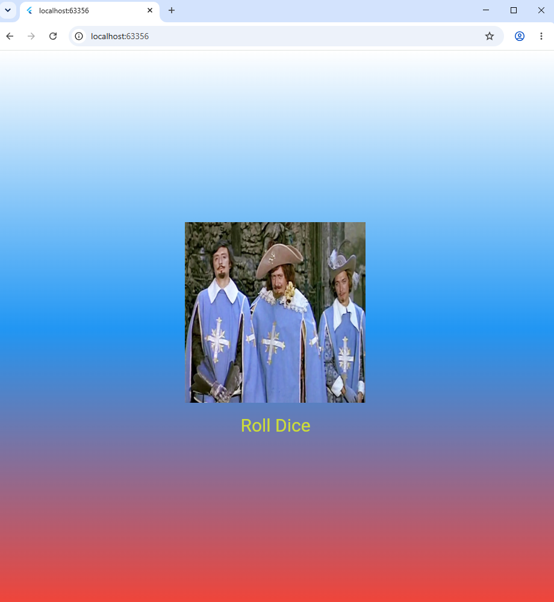

# Лабораторная работа №4–5. Flutter: структура UI и компонентный подход

* **Выполнил:** Имашев Наиль
* **Группа:** ИСП-242
* **Дата сдачи:** 11.11.2026
* **Ссылка на репозиторий:** https://github.com/nailvol/Flutter_Widgets

---

## Что изучили
* Научился строить пользовательский интерфейс во Flutter с помощью дерева виджетов (MaterialApp, Scaffold, Container, Center, Column).
* Освоил создание собственных кастомных виджетов-классов и разделение кода на отдельные модули (.dart файлы) с передачей параметров через конструкторы.
* Настроил подключение локальных ресурсов (изображений игральных костей) через конфигурационный файл pubspec.yaml и их вывод с помощью Image.asset.
* Изучил разницу между статичными (StatelessWidget) и интерактивными (StatefulWidget) виджетами, а также научился обновлять интерфейс через метод setState().
* Реализовал генерацию случайных чисел с помощью стандартной библиотеки dart:math для создания интерактивного приложения «Roll Dice».

---

## Скриншот финального приложения



---

## Инструкция по запуску

1. Клонируйте репозиторий на локальный компьютер:
   ```bash
   git clone https://github.com/nailvol/Flutter_Widgets
   ```
2. Перейдите в папку проекта:
   ```bash
   cd flutter_widgets_imashev
   ```
3. Установите необходимые зависимости:
   ```bash
   flutter pub get
   ```
4. Запустите приложение (например, в браузере Chrome):
   ```bash
   flutter run -d chrome
   ```

---

## Ответы на контрольные вопросы

### 1. Зачем выносить виджеты в отдельные файлы? Что изменится если держать всё в main.dart?
Вынос виджетов в отдельные файлы делает проект модульным, читаемым и удобным для поддержки. Отдельные виджеты легко переиспользовать на разных экранах и быстрее находить в структуре проекта. Если держать весь код в main.dart, файл быстро разрастётся до сотен или тысяч строк с глубокой вложенностью, из-за чего в коде станет сложно ориентироваться, искать ошибки и работать в команде.

### 2. Что такое BuildContext? Почему метод build() принимает его как параметр?
BuildContext - это специальный объект-ссылка, который хранит информацию о точном местоположении конкретного виджета в общем дереве виджетов приложения. Метод build() принимает context как параметр, чтобы Flutter мог правильно встроить отрисовываемый виджет в иерархию экрана, а сам виджет при необходимости мог получить доступ к данным родительских элементов (например, к теме оформления Theme.of(context) или размерам экрана).

### 3. Чем StatelessWidget отличается от StatefulWidget? Приведите пример когда нужен каждый из них.
StatelessWidget - это неизменяемый виджет, у которого нет внутреннего состояния: он отрисовывается один раз на основе переданных параметров и не меняется со временем. StatefulWidget состоит из двух классов (самого виджета и объекта State), умеет хранить изменяемые данные и перерисовывать интерфейс при вызове метода setState().
* **Пример для StatelessWidget:** фоновый контейнер с градиентом (GradientContainer), статичный заголовок, иконка или карточка товара без интерактивных элементов.
* **Пример для StatefulWidget:** наш виджет кубика (DiceRoller), который меняет картинку при нажатии на кнопку, а также счётчики, формы ввода текста, переключатели (чекбоксы) или таймеры.

### 4. Почему Random() создаётся на уровне файла, а не внутри rollDice()?
Объект Random() создаётся один раз на уровне файла (final randomizer = Random();), чтобы переиспользовать один и тот же генератор случайных чисел при каждом нажатии кнопки. Если создавать Random() внутри метода rollDice(), то при каждом клике в оперативной памяти будет выделяться место под новый объект генератора, который сразу же будет удаляться сборщиком мусора — это менее эффективно с точки зрения производительности и расхода памяти.
